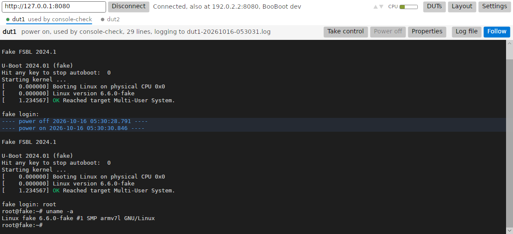

# BooBoot Console

A desktop program that shows the serial console of the DUT, live, as a
terminal connected to it would. Watching needs no session, so agents and
other clients use the DUT as usual, and the console data is not changed in
any way. To type into the console, take control: see [Typing](#typing). With
several DUTs on the board, it shows a tab for each, or all of them at once,
side by side or top and bottom: see [Several DUTs](#several-duts).



To watch with nothing to install, the BooBoot server also has a
[console web page](web.md).

## The window

- **The top bar** is for the BooBoot board and this window: the address of
  the board, Connect or Disconnect (which only stops watching, in this
  window), the state of the connection, the other address of the board and
  the version of its server. On the right: the load of the board (see
  [BooBoot log and load](#booboot-log-and-load)), DUTs and Layout (see
  [Several DUTs](#several-duts)), and Settings.
- **The bar of a DUT**, above its console, is for that DUT: its label and
  name, its state (power, who has its session, lines kept, log file), and
  the buttons that act on it: Take control, Power, Properties, Log file and
  Follow. When the view is narrow, the buttons go under the name.
- **The console** of the DUT. Its right-click menu has Copy, Paste, Copy all,
  Select all, Clear, Save and Properties.

## Features

- **Live output.** The server sends each read from the serial port at once.
- **Output from before.** The server keeps the last 8 MB of output
  (`buffer_size` in the server configuration). The window shows it at start.
- **Terminal text.** Colors, carriage returns, backspaces and line erase work
  as in a terminal.
- **Power switches.** A line shows each power on and power off, with its time.
- **Scrollback.** 200,000 lines by default. Long lines wrap.
- **Follow.** The view follows new output. Scrolling up stops it, so that the
  text stays in place. End or the Follow button of the DUT starts it again.
- **Copy and save.** Select with the mouse (double-click: word, triple-click:
  line), copy with Ctrl+C, select all with Ctrl+A. Save writes all the text
  to a file (Ctrl+S). Clear (Ctrl+L) empties the view. All are also in the
  right-click menu of the console.
- **Logs.** In the Log file menu of a DUT, "Start new log" writes all output from now on to
  a new file `PREFIX-YYYYMMDD-HHMMSS.log` in the log folder; "Stop log" stops
  it, and "Open log folder" opens the folder. The prefix is the DUT name
  unless set; with several DUTs, a prefix set is followed by the DUT name.
  Options: start a log when connected, and a new log file at each power on.
  Logs have the text without escape codes, one line per line.
- **Connection.** When the connection is lost, the program connects again and
  continues where it was: no output is lost unless it left the server memory
  in between (a line then says how many bytes were lost). A line also says
  when the server was restarted.

When the server address is a name, the top bar also shows the address of the
board (`also at 10.1.2.3:8080`), for where the name does not work, like over
a VPN. The program keeps the addresses of the board, and uses
them by itself when the name is not found: see [remote.md](remote.md).

## Several DUTs

With the address of a board that has several DUTs, like
`http://booboot.local:8080`, the window shows a tab for each DUT, with the bar
of the DUT of the current tab under the tabs. Each DUT has its own view,
scrollback, log files and session. A tab shows:

- a dot: green when the DUT is on, gray when it is off,
- "in control" when this program has the session of the DUT, or "used by"
  and the client that has it,
- a bullet when new output came while another tab was shown.

Ctrl+Tab shows the next DUT, Ctrl+Shift+Tab the previous one. The DUTs button
shows or hides DUTs, and the BooBoot log: a hidden DUT is not watched, and the
program remembers it for that board. With the address of one DUT, like
`http://booboot.local:8080/duts/dut2`, the window shows that DUT only. With
one DUT on the board, there are no tabs.

The Layout button, next to the DUTs button, shows the DUTs one at a time in
tabs, or all the DUTs shown at once: "Side by side" or "Top and bottom", each
view with the bar of its DUT, in place of the tabs. A divider between two
views changes their sizes. What is typed goes to the view clicked last,
whose bar has a blue line under it; Ctrl+Tab goes to the next one. The
program remembers the layout.

Several windows work too, like one for each DUT on another screen: start the
program again with the address of the DUT, like
`BooBootConsole-win-x64.exe http://booboot.local:8080/duts/dut2`. An address
given this way is not kept: the next start without one uses the last address
typed. With a log started on connect, hide that DUT in the window of the
board, or its output goes to two log files.

## BooBoot log and load

"BooBoot log", in the menu of the DUTs button, shows the messages of the
BooBoot server as one more view, read only: what it does (sessions, power
switches, SD card, console commands of clients, scripts) and its problems,
like a serial adapter or a USB-SD-Mux not found, or a DUT that did not start.
These are the messages that `journalctl -u booboot` shows on the board. The
program remembers it for the board.

The top bar shows the load of the board, measured every second. The up
arrow lights when the board receives network traffic (more than 4 KB/s, from
any client), the down arrow when it sends; brighter with more traffic. The
CPU gauge goes from green to red with the CPU use. Its tooltip gives the
numbers, and the temperature of the board.

## Properties

The Properties button of a DUT, in its bar, shows the DUT on the board, the
same for everyone (Settings are those of this program, on this computer):

- its name and its address, like `http://booboot.local:8080/duts/dut1`, to
  copy for `booboot --dut dut1`, an agent or a colleague,
- its label: free text shown with its name in its bar, its tab and the title,
  here and in the other viewers, like `ZCU102 rev B, bench 3`.
  In control, "Set label" (or Enter) changes it for everyone; empty removes
  it,
- its serial adapter and baud rate, its relay and power state, the side of
  its SD card, and the version and addresses of the BooBoot server. For a
  part that the DUT goes without, it says "no relay", "no USB-SD-Mux" or
  "no serial console".

A right-click on the bar or the tab of a DUT, then "Properties...", also
opens it.

## Typing

"Take control" opens the BooBoot session, in the name of
`BooBoot Console USER@COMPUTER`. While it is open, other clients that need
the session (agents, `booboot` commands) get `busy`, as with any session.
When another client has the session, the program asks before taking it
over, and says whether that client is gone (a viewer or MCP server that
stopped its heartbeats, like a program closed abruptly: taking over is
safe) or connected (someone may be using the DUT). A session left by this
program on the same computer, after a crash, is taken over without asking.
A blue frame shows that the keys go to the DUT. The view then shows the
cursor, and follows the output at each key.

- **Keys.** Text, Enter, Backspace, Tab, Escape, the arrows, Home, End,
  Insert and Delete are sent as a terminal sends them. Ctrl+letter sends the
  control character: Ctrl+C stops a program on the DUT, Ctrl+D ends a shell.
- **Copy and paste.** Ctrl+C copies when text is selected; with no selection
  it goes to the DUT. Ctrl+Shift+C always copies. Ctrl+V pastes the clipboard
  to the DUT, with each line break sent as Enter.
- **View commands.** Page Up and Page Down still scroll. With Ctrl+Shift:
  Ctrl+Shift+A selects all, Ctrl+Shift+L clears, Ctrl+Shift+S saves.
- **Power.** Next to "Take control", "Power on" or "Power off", after the
  power state of the DUT, switches it. It works only in control. "Power off"
  asks first. Power on also gives the SD card back to the DUT. A DUT without
  relay has no power button.
- **Label.** Properties sets the label of the DUT, in control: see
  [Properties](#properties).
- **Release.** "Release control" closes the session. Closing the window also
  does. When no key is sent for the session timeout (300 s by default), the
  session ends and the bar of the DUT says so.
- **Busy.** If another client has the session, the program shows who and its
  idle time, and asks before taking it over. If another client takes it
  over, typing stops and the bar of the DUT says who.

## Run

**Ready-built program.** Each release has a single program file for Windows
and Linux, with nothing else to install. From the
[latest release](https://github.com/sonatique/BooBoot/releases/latest), download `BooBootConsole-win-x64.exe` or
`BooBootConsole-linux-x64`. On Linux, make the file executable first:
`chmod +x BooBootConsole-linux-x64`. CI also builds them at each push: the
artifacts of the latest CI run have the changes made since the release (a
GitHub login is needed, and they are kept 30 days).

**From the sources**, on any system with the .NET 10 SDK:

```sh
dotnet run --project client/csharp/BooBootConsole -- http://booboot.local:8080
```

To build a single program file yourself (RID: `win-x64`, `linux-x64`,
`linux-arm64`, `osx-arm64`, ...):

```sh
dotnet publish client/csharp/BooBootConsole -c Release -r win-x64 --self-contained \
    -p:PublishSingleFile=true -p:IncludeNativeLibrariesForSelfExtract=true \
    -p:EnableCompressionInSingleFile=true -p:PublishReadyToRun=true -p:PublishTrimmed=true \
    -o publish
```

`PublishTrimmed` leaves out the parts of .NET that the program does not use,
and `PublishReadyToRun` compiles it ahead of time. Together they make a file
of about 35 MB that shows its window in well under a second.

The build uses Avalonia, which sends anonymous usage data while building. Set
`AVALONIA_TELEMETRY_OPTOUT=1` to turn this off.

The server address comes from the command line, or else is the last one
typed. It is the address of the board, for all its DUTs, or of one DUT, like
`http://booboot.local:8080/duts/dut2`.

## Settings

The Settings button opens them. They are kept in `settings.json`, in
`%APPDATA%\BooBootConsole` on Windows and `~/.config/BooBootConsole` on Linux
and macOS.

| Setting | Default |
|---|---|
| Log folder | `BooBoot logs` in the documents folder |
| File name prefix | the DUT name; with a prefix and several DUTs, PREFIX-NAME |
| Start a log when connected | off |
| New log file at each power on | off |
| Scrollback lines | 200,000 |
| Text size | 13 |
| Fonts | Cascadia Mono, Consolas, Menlo, DejaVu Sans Mono, Liberation Mono, monospace (the first one found) |

The Layout button sets the layout, and the DUTs button the DUTs shown: both are
kept in the same file.

## How it works

The program finds the DUTs of the board in `GET /api/v1/status` (`duts`),
then reads `GET /duts/NAME/api/v1/console/stream` for each (see
[api.md](api.md)): one HTTP connection on which the server sends the output
and the power switches as they come. The server reads the serial port all the time, whether viewers
are connected or not. Viewers only read its memory, so the DUT does not see
them, and any number of them can watch. A slow viewer never slows the server:
if it falls behind by more than the server memory, it skips output.
Taking control opens a session (`POST /duts/NAME/api/v1/session`), and the
keys go through `POST /duts/NAME/api/v1/console/write`.

## Limits

- The view is line based: it only writes to the last line, like a log.
  Programs that draw on the whole screen (`top`, `vi`, `menuconfig`) do not
  show well. For them, use `booboot console attach` in a terminal.
- Characters wider than others (CJK, emoji) break the alignment of their line.
